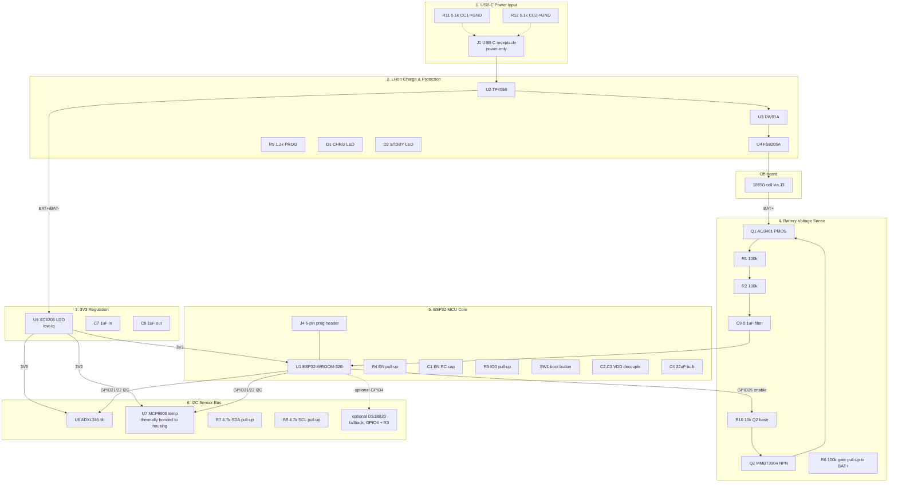

# Block Diagram — Temp + Gravity Module

7 functional blocks (> 3 ⇒ orchestrator should select **modular** coding
mode at the coding stage, one `skidl-block-coder` per block below).

## Block list

| # | Block | Key parts | Interface nets |
|---|---|---|---|
| 1 | USB-C Power Input | J1, R11, R12 | VBUS, CC1, CC2, GND |
| 2 | Li-ion Charge & Protection | U2, U3, U4, R9, D1, D2, R13, R14 | VBUS, BAT+, BAT-, CHRG, STDBY |
| 3 | 3V3 Regulation | U5, C7, C8 | BAT+ (post-protection), 3V3 |
| 4 | Battery Voltage Sense (gated) | Q1, Q2, R1, R2, R6, R10, C9 | BAT+, 3V3, GPIO25, GPIO34 |
| 5 | ESP32 MCU Core | U1, R4, C1, R5, SW1, C2, C3, C4, J4 | 3V3, EN, IO0, TX, RX |
| 6 | I2C Sensor Bus | U6, U7, R7, R8, (optional DS18B20 + R3) | 3V3, GPIO21, GPIO22, (GPIO4) |
| 7 | Off-board cell | 18650 + J3 | BAT+, BAT- |
