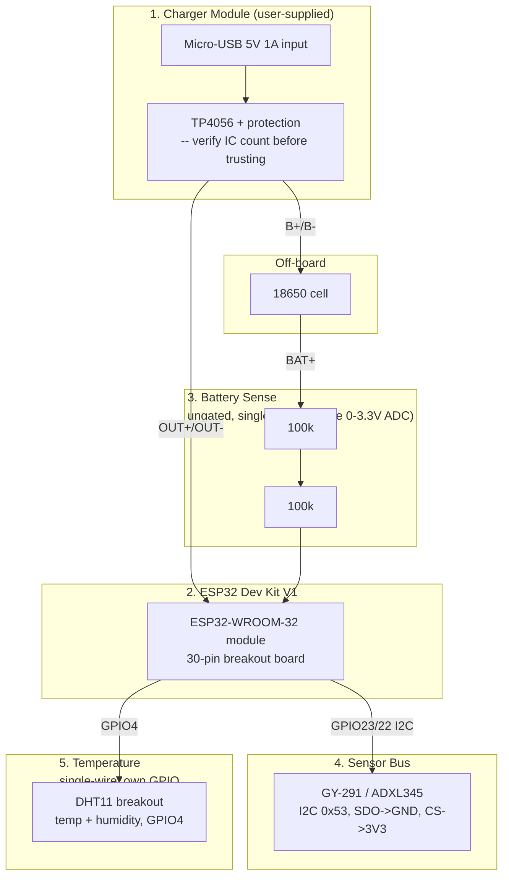

# Block Diagram — ESP32 Dev Kit V1 Bench Prototype

5 blocks, coded modularly for consistency with the ESP8266 sibling and
the production `circuits/temp_gravity_module/` package.

## Block list

| # | Block | Parts | Interface nets |
|---|---|---|---|
| 1 | Charger Module | TP4056 breakout (J-USB, B+/B-, OUT+/OUT-) | VBUS(5V), BAT_PLUS, BAT_MINUS |
| 2 | ESP32 Dev Kit V1 | ESP32-WROOM-32 module on a 30-pin breakout board | VIN, 3V3, GND, GPIO4, GPIO22, GPIO23, GPIO25, GPIO34 |
| 3 | Battery Sense (ungated) | R1 (100k), R2 (100k) | BAT_PLUS, GND, BATT_SENSE_ADC |
| 4 | Sensor Bus | GY-291 (ADXL345) | 3V3, GND, SDA, SCL |
| 5 | Temperature | DHT11 breakout | 3V3, GND, DHT_DATA |
