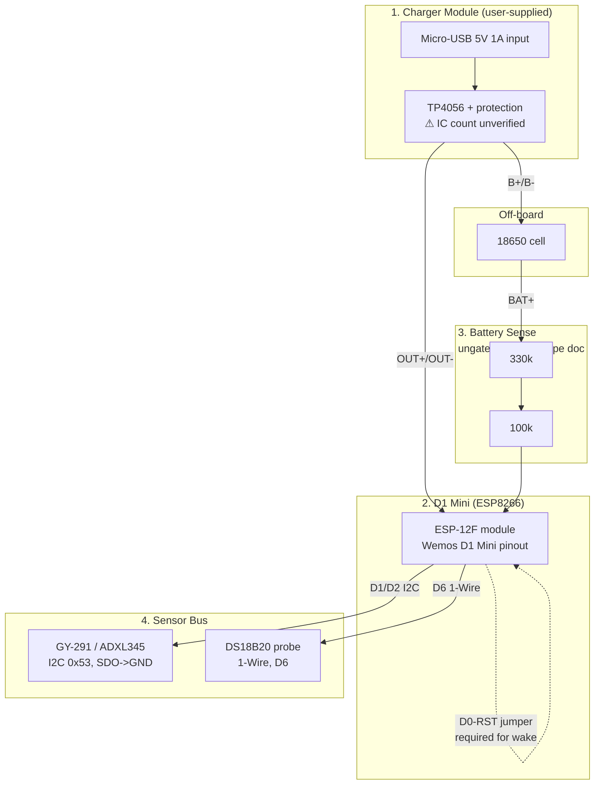

# Block Diagram — ESP8266 D1 Mini Bench Prototype

4 blocks (≤3 would be monolithic per the orchestrator's rule; 4 blocks
still coded modularly for consistency with `circuits/temp_gravity_module/`
and because each block maps 1:1 to a physical module you wire
independently on the breadboard).

## Block list

| # | Block | Parts | Interface nets |
|---|---|---|---|
| 1 | Charger Module | TP4056 breakout (J-USB, B+/B-, OUT+/OUT-) | VBUS(5V), BAT_PLUS, BAT_MINUS |
| 2 | D1 Mini (ESP8266) | ESP-12F module on Wemos-pinout carrier | 5V, 3V3, GND, D0/RST, D1, D2, D6, A0 |
| 3 | Battery Sense (ungated) | R1 (330k), R2 (100k) | BAT_PLUS, GND, BATT_SENSE_ADC |
| 4 | Sensor Bus | GY-291 (ADXL345), DS18B20 probe, R3 (4.7k pull-up if needed) | 3V3, GND, SDA, SCL, ONE_WIRE |
